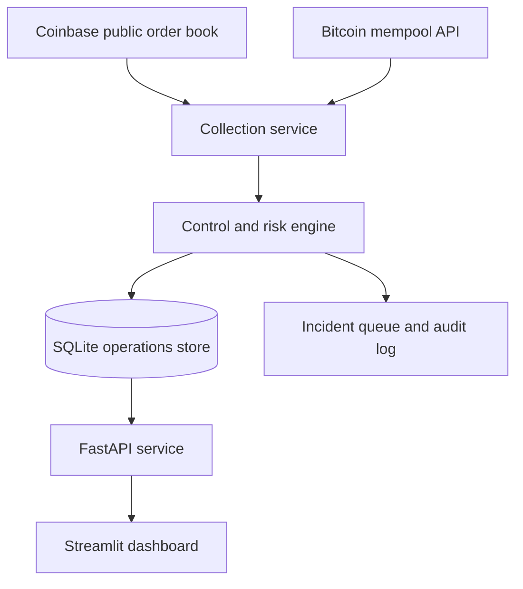

# Architecture

The project deliberately separates providers, calculations, controls, persistence and presentation so each part can be tested or replaced independently. Public read-only data is used; the system has no exchange credentials and cannot place trades or move funds.

