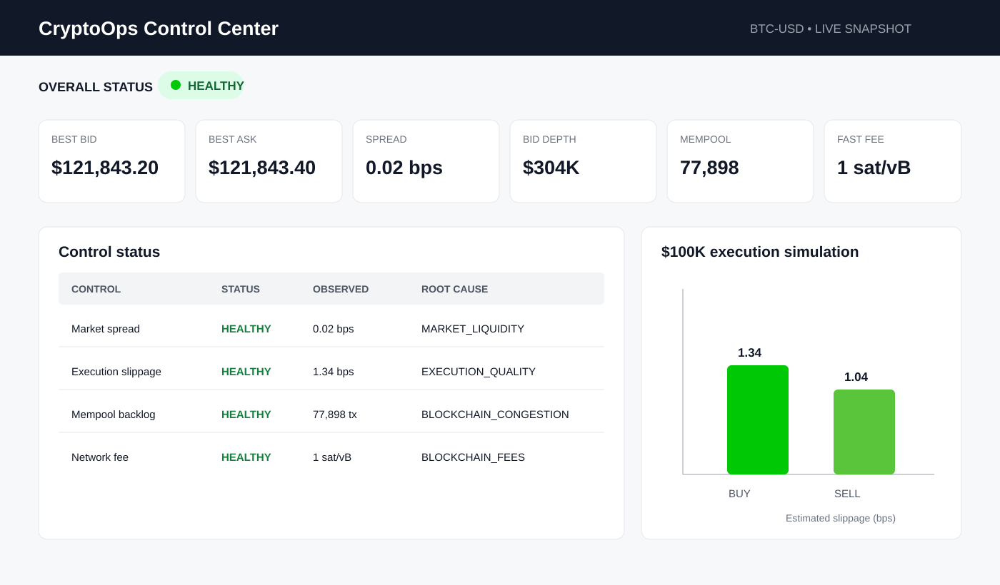
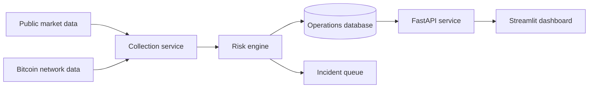

# CryptoOps Control Center

> A portfolio case study in crypto operations, product monitoring, risk controls and incident response.

CryptoOps Control Center is an operations-monitoring platform designed for cryptocurrency markets and Bitcoin network health. It combines market-liquidity monitoring, execution-quality analysis, blockchain congestion controls, transaction-status tracking and auditable incident-management workflows.

The project demonstrates how a crypto operations team can detect risk early, investigate root causes, coordinate with product and engineering teams and protect the customer experience as financial products scale.

## What It Demonstrates

- **Market operations:** Tracks bid-ask spreads, order-book depth and simulated $100,000 execution slippage.
- **Blockchain operations:** Monitors Bitcoin mempool congestion, network fees and block height.
- **Transaction operations:** Reviews confirmation status, fee rates and potential transfer delays.
- **Risk controls:** Applies configurable warning and critical thresholds with recommended actions.
- **Incident response:** Supports open, acknowledged and resolved states with ownership and resolution notes.
- **Product operations:** Includes product requirements, launch criteria, operating procedures and readiness controls.
- **Engineering quality:** Uses typed data models, API boundaries, SQLite persistence, automated testing, CI and Docker.

## Dashboard Overview

The dashboard provides an at-a-glance view of:

- Overall operational health
- Best bid and ask prices
- Market spread and available liquidity
- Simulated buy and sell slippage
- Bitcoin mempool size and recommended fees
- Control status and root-cause categories
- Open incidents, owners and corrective actions
- Auditable incident updates

## System Design

## Control Framework

| Control | Warning | Critical | Operational Response |
|---|---:|---:|---|
| Market spread | 12 bps | 30 bps | Review venue health and order-book depth |
| $100K execution slippage | 20 bps | 50 bps | Reduce order size or route incrementally |
| Bitcoin mempool backlog | 100,000 transactions | 200,000 transactions | Review confirmation expectations and customer messaging |
| Fastest network fee | 50 sat/vB | 100 sat/vB | Validate withdrawal fees and disclosures |

## Incident Workflow

1. Collect current market and blockchain data.
2. Compare observed values with warning and critical thresholds.
3. Create an incident when a control is breached.
4. Assign an owner and investigate the likely root cause.
5. Record corrective actions and relevant stakeholder updates.
6. Resolve the incident with a written resolution note.
7. Preserve each status change in the audit log.

## Product Documentation

- [Product Requirements Document](PRD.md)
- [Operations Runbook](RUNBOOK.md)
- [System Architecture](ARCHITECTURE.md)

## Technology Stack

- Python
- FastAPI and REST APIs
- SQL and SQLite
- Streamlit
- pandas and Plotly
- Pydantic
- Docker and Docker Compose
- Pytest
- GitHub Actions

## Validation

The implementation was validated through automated tests covering:

- Spread calculations
- Market-order simulation
- Insufficient-liquidity handling
- Warning and critical severity bands
- Root-cause classification
- Incident creation and resolution
- Audit-log generation
- API health and transaction-ID validation

The data pipeline was also tested using live public BTC-USD order-book and Bitcoin network data.

## Responsible Design

The system uses public, read-only data. It does not store exchange credentials, customer information, wallet addresses or private keys. It cannot place trades, transfer assets or provide investment recommendations. Missing provider data is treated as an operational failure rather than a healthy state.

## Resume Summary

> Built a Python and SQL crypto-operations platform that monitors order-book liquidity, execution slippage, Bitcoin network health and transaction confirmations; detects control breaches, recommends corrective actions and manages incidents through an auditable workflow.

## Author

**Sanjayan Visagendran**  
[GitHub](https://github.com/sanjayanvisagendran) · [LinkedIn](https://www.linkedin.com/in/sanjayan-visagendran)
