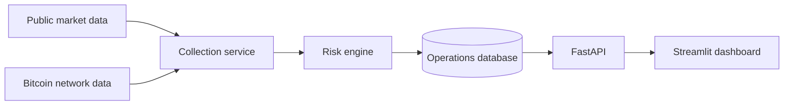

# CryptoOps Control Center

An operations and product-monitoring platform for crypto markets and Bitcoin network health. It combines live public market data, execution-quality simulation, liquidity controls, blockchain congestion monitoring, incident management and auditable operating procedures.

This project was designed around the work of a crypto operations team: detect risk early, investigate root causes, coordinate with product and engineering, and protect the customer experience while products scale.


## What it demonstrates

- **Market operations:** spread, order-book depth and simulated $100K execution slippage
- **Blockchain operations:** mempool backlog, fee pressure and block-height monitoring
- **Transaction operations:** confirmation count, fee-rate analysis and delayed-transfer escalation guidance
- **Risk controls:** configurable warning and critical thresholds with recommended actions
- **Incident response:** open, acknowledge and resolve workflow with ownership and audit logs
- **Product operations:** PRD, launch criteria, operating runbook and readiness-oriented design
- **Engineering quality:** typed models, API boundaries, SQLite persistence, tests, CI and Docker

## System design



## Quick start

### Docker

```bash
cp .env.example .env
docker compose up --build
```

- API documentation: http://localhost:8000/docs
- Operations dashboard: http://localhost:8501

### Local Python

```bash
python -m venv .venv
source .venv/bin/activate  # Windows: .venv\Scripts\activate
pip install -e ".[dashboard,dev]"
mkdir -p data
uvicorn cryptoops.api:app --reload
```

In another terminal:

```bash
streamlit run src/cryptoops/dashboard.py
```

## API workflow

Collect and evaluate a live snapshot:

```bash
curl -X POST "http://localhost:8000/v1/snapshots/collect?product=BTC-USD"
```

Inspect incidents:

```bash
curl "http://localhost:8000/v1/incidents?status=OPEN"
```

Monitor a Bitcoin transaction and flag possible delay:

```bash
curl "http://localhost:8000/v1/network/transactions/<TXID>?first_seen_at=2026-10-09T12:00:00Z"
```

Acknowledge an incident:

```bash
curl -X PATCH "http://localhost:8000/v1/incidents/1" \
  -H "Content-Type: application/json" \
  -d '{"status":"ACKNOWLEDGED","owner":"Sanjayan","resolution_note":"Investigating venue depth"}'
```

## Control framework

| Control | Warning | Critical | Operational response |
|---|---:|---:|---|
| Market spread | 12 bps | 30 bps | Review venue health and depth |
| $100K execution slippage | 20 bps | 50 bps | Reduce size or route incrementally |
| Bitcoin mempool backlog | 100,000 tx | 200,000 tx | Review confirmation expectations |
| Fastest network fee | 50 sat/vB | 100 sat/vB | Validate withdrawal fee estimates |

All thresholds are configurable through environment variables.

## Testing

```bash
pytest
```

Tests cover spread calculations, market-order simulation, insufficient depth, severity bands and root-cause classification. GitHub Actions runs tests and bytecode compilation on every push and pull request.

## Responsible design

The application uses public, read-only endpoints. It stores no credentials, customer data, wallet addresses or private keys. It does not place trades or move funds. Provider failures are explicit and are never represented as a healthy system state.

## Product documentation

- [Product requirements](docs/PRD.md)
- [Operations runbook](docs/RUNBOOK.md)
- [Architecture](docs/ARCHITECTURE.md)

## Resume-ready summary

> Built a Python and SQL crypto-operations platform that monitors order-book liquidity, execution slippage, Bitcoin network health and transaction confirmations; detects control breaches, recommends corrective actions and manages incidents through an auditable workflow.

